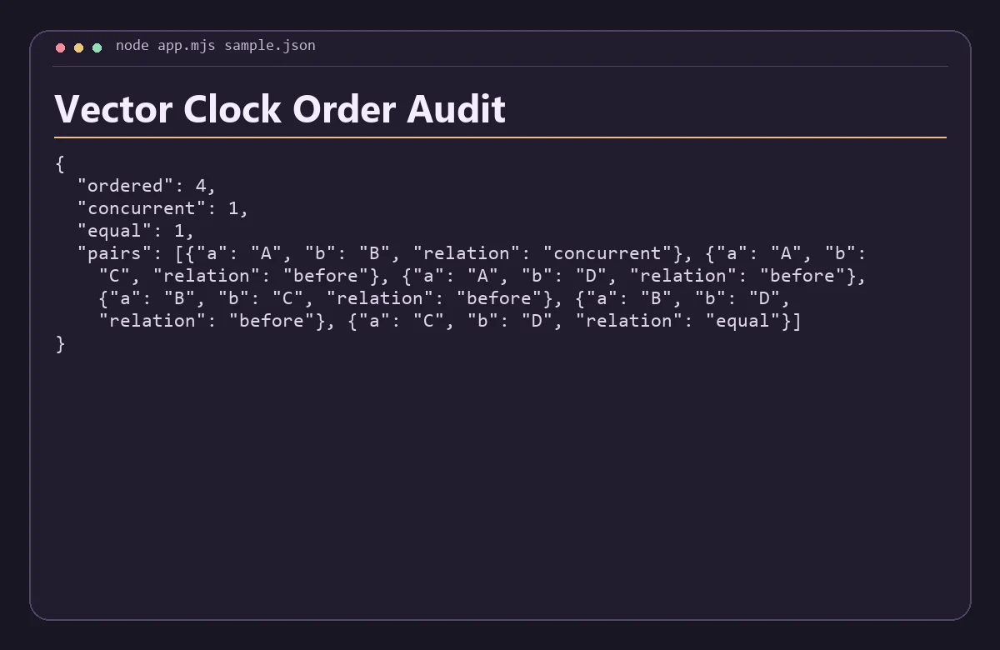

# Vector Clock Order Audit

Classify pairs of distributed events as ordered, concurrent, or equivalent using vector clocks.



## Run

Install Node.js 22 or newer. Run these commands from the repository root.

```sh
node app.mjs sample.json
```

Replace `sample.json` with a JSON file following the same structure. The app prints a JSON report to standard output.

Use nonnegative integer components in the same process order for all events. A follows B when A is at least as large everywhere and strictly larger somewhere. Equal timestamps alone do not identify the same event.

## Verify

Run `python check.py` with Python 3.11 or newer after the build step when applicable. The check verifies the bundled scenario and confirms that an invalid input returns an error.
